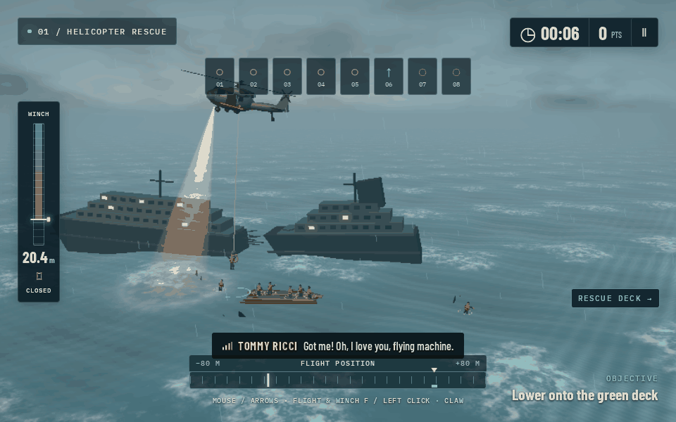

<a id="top"></a>

<p align="center">
  
</p>

<p align="center">
  <strong>Fly into the storm. Pull people from the water. Get them home.</strong><br />
  A cinematic browser rescue game controlled with your two palms.
</p>

<p align="center">
  <a href="#quick-start"><strong>LAUNCH THE GAME</strong></a> &nbsp; / &nbsp;
  <a href="#mission">THE MISSION</a> &nbsp; / &nbsp;
  <a href="#controls">CONTROLS</a> &nbsp; / &nbsp;
  <a href="#development">BUILD ROOM</a> &nbsp; / &nbsp;
  <a href="#deployment">DEPLOY</a>
</p>

<p align="center">
  <a href="https://github.com/MAC-Fest-2026/shipwreck/actions/workflows/ci.yml"></a>
  <br />
  <sub>TYPESCRIPT &nbsp; · &nbsp; THREE.JS &nbsp; · &nbsp; MEDIAPIPE &nbsp; · &nbsp; PREACT &nbsp; · &nbsp; VITE</sub>
</p>

<p align="center">
  
</p>

---

<a id="quick-start"></a>

## 01 / Clear for takeoff

**Clone. Install. Fly.** Every runtime asset comes aboard with the repository.

| Before you launch | Version / requirement |
| :--- | :--- |
| Node.js | **22.22.1** — pinned in [`.nvmrc`](.nvmrc) |
| Package manager | **pnpm 11.5.3** — pinned in [`package.json`](package.json) |
| Browser | Desktop Chrome or Edge with WebGL2 and hardware acceleration |
| Input | Webcam and two hands, or keyboard and mouse |

```sh
npm install --global pnpm@11.5.3
git clone https://github.com/MAC-Fest-2026/shipwreck.git
cd shipwreck
pnpm install --frozen-lockfile
pnpm dev
```

Open the URL Vite prints, normally **<http://127.0.0.1:5173>**. Keep the terminal running; source changes reload automatically.

> [!TIP]
> Choose **Keyboard & mouse → callsign → Flight school** to jump into training. For palm controls, choose **Play with hands**, allow the webcam, and follow calibration.

Camera access needs **localhost or HTTPS**. Use the local server rather than opening `index.html` directly. No backend, API keys, or environment file is required. An up-to-date Corepack installation can also select the pinned pnpm version; older launchers may fail with pnpm 11.

<a id="mission"></a>

## 02 / Eight lives. One way home.

A passenger ship has broken apart. Survivors cling to wreckage. Sharks circle below. You arrive with a helicopter, a rescue claw, and very little time.

<table>
  <tr>
    <td width="50%" valign="top">
      <h3>01 — Fly + rescue</h3>
      <p>Hold the helicopter steady. Lower the winch. Close the claw over a survivor, lift them clear, and release low over the green rescue deck.</p>
      <p><strong>The longer you wait, the closer the sharks get.</strong></p>
    </td>
    <td width="50%" valign="top">
      <h3>02 — Take the helm</h3>
      <p>Step into the boat's cockpit. Thread the wreckage, turn away from shark wakes, follow the lighthouse, and slow down for landfall.</p>
      <p><strong>The rescue ends when you reach the island.</strong></p>
    </td>
  </tr>
</table>

<p align="center">
  <picture>
    <source media="(prefers-reduced-motion: reduce)" srcset="docs/media/rescue.png" />
    
  </picture>
  <br />
  <sub>ACTUAL GAMEPLAY · BUILT-IN REPLAY · WEBGL2</sub><br />
  <sub>Prefer a still? <a href="docs/media/rescue.png">Helicopter rescue</a> &nbsp; / &nbsp; <a href="docs/media/boat.png">Island run</a></sub>
</p>

### Built for the mission

| | What you get |
| :--- | :--- |
| **Your hands are the controls** | Two-palm tracking, calibration, tracking-loss recovery, and a keyboard/mouse fallback. |
| **A sea that moves with you** | Rolling procedural water, a stormy sky, rain, searchlights, and cinematic transitions. |
| **Voices in the storm** | 114 bundled synthetic voice lines, reactive radio chatter, captions, and sound settings. |
| **Every run leaves a record** | Callsigns, scores, saved/lost survivors, and a local run log backed by IndexedDB. |
| **Camera processing stays local** | Self-hosted MediaPipe runtime and recognition model; webcam frames stay on the device. |
| **Everything comes aboard** | GLB models, WAV voices, artwork, dialogue, and notices ship with a normal Git clone. |

<a id="controls"></a>

## 03 / Your hands. Your rescue.

| Action | Two-palm controls | Keyboard / mouse |
| :--- | :--- | :--- |
| **Move helicopter** | Move your **right palm** horizontally | Mouse horizontally or <kbd>←</kbd> / <kbd>→</kbd> |
| **Raise / lower winch** | Move your **left palm** up / down | Mouse vertically or <kbd>↑</kbd> / <kbd>↓</kbd> |
| **Close / open claw** | Close / open your **left palm** | Hold / release <kbd>F</kbd> or left mouse button |
| **Steer boat** | Tilt both palms like a steering wheel | <kbd>A</kbd> / <kbd>D</kbd> |
| **Throttle up / down** | Raise / lower both palms | <kbd>W</kbd> / <kbd>S</kbd> |
| **Pause** | Hold both thumbs up | <kbd>Esc</kbd> |

Scores and settings belong to the current browser and origin. Keeping the same host and port keeps the same local scorebook.

<a id="development"></a>

## 04 / Welcome to the build room

**Start here:** [`src/app/tuning.ts`](src/app/tuning.ts) for game tuning, [`src/ui/`](src/ui/) for the interface, and [`src/sim/`](src/sim/) for rescue, boat, and water behavior.

```text
shipwreck/
├── src/
│   ├── app/            Controller, settings, tuning
│   ├── game/           Session flow, replay, events, scoring
│   ├── sim/            Rescue, boat, shared water simulation
│   ├── input/          Hand tracking, calibration, keyboard, emulator
│   ├── render/         Three.js scene, models, graphics backends
│   ├── audio/          Radio, voices, synthesized sound
│   ├── ui/             Preact views and styles
│   ├── persistence/    Local score storage
│   └── core/           Shared math
├── public/             Runtime assets + third-party notices
├── tests/              Unit, fairness, and browser integration tests
├── scripts/            Static server, asset tools, performance harness
└── docs/               Design, plans, verification, and README media
```

### The command deck

| Command | Purpose |
| :--- | :--- |
| `pnpm dev` | Start Vite with live reload |
| `pnpm lint` | Lint the game and tests |
| `pnpm test` | Run unit tests and seeded fairness simulations |
| `pnpm build` | Type-check and build the production site |
| `pnpm e2e` | Run the Playwright browser suite |
| `pnpm serve` | Serve `dist/` with the project's security headers |
| `pnpm preview` | Preview `dist/` through Vite |
| `pnpm perf` | Run the browser performance harness |
| `pnpm format` | Format source, tests, configuration, and docs |

<details>
<summary><strong>Run the full verification sequence</strong></summary>

```sh
pnpm lint
pnpm test
pnpm build
pnpm exec playwright install chromium
pnpm e2e
```

On Linux, browser system libraries may also be needed:

```sh
pnpm exec playwright install --with-deps chromium
```

Playwright starts its own dev server on **port 4173**. Stop any existing service on that port first. Coverage includes onboarding, replay and durable scores, synthetic-camera startup, tracking recovery, and WebGL2 water shader parity. See [verification notes](docs/VERIFICATION.md) for the evidence and pending physical-camera, human, and reference-hardware checks.

</details>

<details>
<summary><strong>Developer modes: replay, hand emulator, and kiosk</strong></summary>

Open the Vite URL with **`?debug=1`** for the hand emulator and the `window.shipwreck` debug API:

```js
await window.shipwreck.startReplay()
window.shipwreck.snapshot()
window.shipwreck.advanceToBoat()
```

**`?kiosk=1`** enables the kiosk flow and disables debug mode. Use the actual host and port printed by your dev server. Debug tools are available in development builds.

</details>

### Keep the crew in sync

1. Create a branch for your change and keep the game runnable.
2. Run the relevant checks before opening a pull request.
3. Commit **`pnpm-lock.yaml`** with dependency changes and update [asset records](docs/ASSETS.md) when adding or replacing media.

The live scene currently uses **WebGL2**. The adapters under `src/render/graphics.ts` and `src/render/webgpu/` prepare for future work; WebGPU needs its own `SceneMaterials` implementation before selection. The [V2 plan](docs/PLAN_V2.md) and [fidelity ledger](docs/FIDELITY_LEDGER.md) track that work.

<a id="deployment"></a>

## 05 / Ship the rescue

```sh
pnpm build
pnpm serve
```

Your production build is ready at **<http://127.0.0.1:4174>**. Deploy the contents of **`dist/`** to an HTTPS static host.

| Deployment detail | What matters |
| :--- | :--- |
| **Hosting** | Static files over HTTPS; localhost is trusted for local play |
| **Headers** | Apply [`public/_headers`](public/_headers), or the equivalent for your host |
| **WASM** | Serve `.wasm` with `Content-Type: application/wasm` |
| **Base path** | Vite's relative base supports a subdirectory such as `/shipwreck/` |
| **Assets** | Deploy the full build, including `mediapipe/`, `models/`, audio, and notices |
| **Server application** | None required |

Runtime files use ordinary Git storage. A normal clone/install/build needs no Git LFS, asset regeneration, or external runtime CDN. Generated dependencies, build/test output, local secrets, and unused full-resolution art references are excluded from version control.

<a id="asset-tools"></a>

## 06 / Under the hood

The checked-in assets are ready to use. Open these field notes when you want to change their sources.

<details>
<summary><strong>Regenerate helicopter and rescue-vessel models</strong></summary>

Edit [`src/render/models.ts`](src/render/models.ts). Install Playwright Chromium, then start the dev server on port 4173:

```sh
pnpm dev --port 4173 --strictPort
```

In another terminal:

```sh
node scripts/export-models.mjs
```

This writes the two GLB models under `public/models/`.

</details>

<details>
<summary><strong>Rewrite dialogue and regenerate synthetic voices</strong></summary>

The authored bank is in [`scripts/dialogue.mjs`](scripts/dialogue.mjs); the runtime bank is [`public/dialogue/lines.en.json`](public/dialogue/lines.en.json).

```sh
node scripts/dialogue.mjs
python3 scripts/gen-voice.py
```

Run these in order. Regenerating the dialogue JSON removes generated audio paths; voice generation restores the paths and creates the WAVs. It needs **Python 3** and a local **eSpeak NG shared library with voice data**. These tools are optional for normal development and play.

</details>

<details>
<summary><strong>Profile performance or update MediaPipe</strong></summary>

With the dev server on port 4173, run `pnpm perf`. The harness accepts `SHIPWRECK_BENCH_URL`, `SHIPWRECK_SOFTWARE_GL`, and `SHIPWRECK_P95_MS`; see [`scripts/perf.mjs`](scripts/perf.mjs).

Keep MediaPipe pinned. [`vite.config.ts`](vite.config.ts) patches the SDK's metrics transport and deliberately fails if an update changes that code. Review the patch and update the matching files under `public/mediapipe/` together when changing the SDK version.

</details>

<a id="field-notes"></a>

## 07 / The field notes

| Document | Open it for… |
| :--- | :--- |
| [Original brief](docs/SHIPWRECK.md) | The story, design pillars, systems, and acceptance targets |
| [Implementation plan](docs/PLAN.md) | The original milestone sequence |
| [V2 development plan](docs/PLAN_V2.md) | The next graphics, physics, and asset milestones |
| [Fidelity ledger](docs/FIDELITY_LEDGER.md) | What is implemented and what still needs evidence |
| [Verification](docs/VERIFICATION.md) | Tested behavior, reproduction steps, and manual gates |
| [Reference rig](docs/REFERENCE_RIG.md) | The provisional hardware and performance baseline |
| [Asset inventory](docs/ASSETS.md) | Asset sources, generation tools, and bundled notices |

README illustrations are original project graphics. The animated preview and stills are captures of the game's built-in replay; they demonstrate gameplay rather than hardware performance. Keep [`public/notices/`](public/notices/) with distributed builds.

---

<p align="center">
  <strong>THE STORM IS LOUD. THE MISSION IS SIMPLE.</strong><br />
  <sub>Get them out. Get them aboard. Bring them home.</sub><br /><br />
  <a href="#top">↑ BACK TO THE SURFACE</a>
</p>
